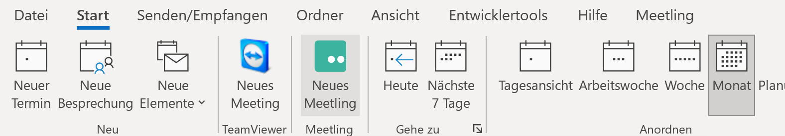
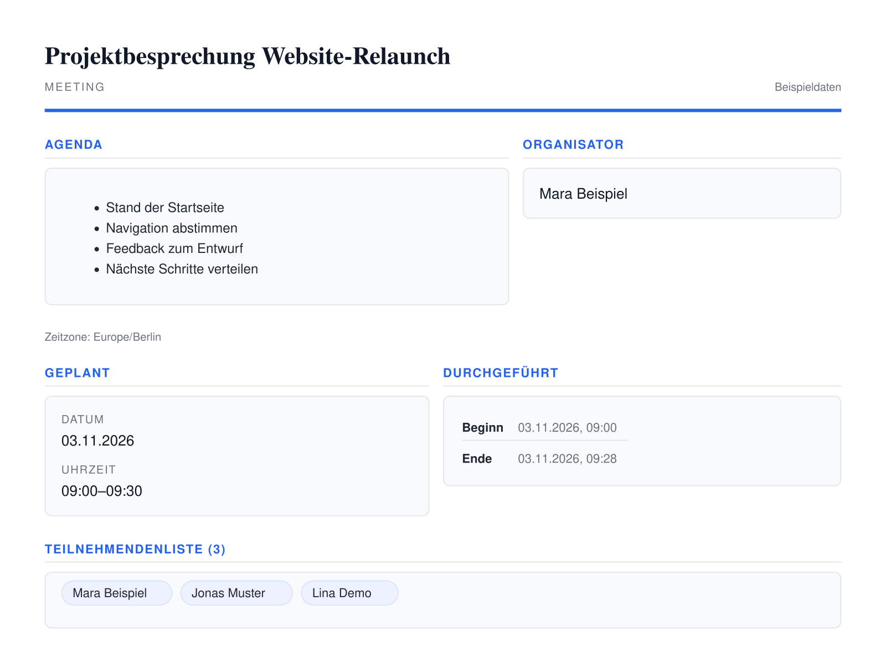

## Was sich mit Meetling 1.6 ändert

Sie planen eine Besprechung in Outlook. Der Termin steht, jetzt fehlt nur noch der Videolink. Mit Meetling 1.6 können Sie den Konferenzraum direkt aus dem Outlook-Kalender anlegen. Das Add-in schreibt den Beitrittslink und, bei eingerichteter Telefoneinwahl, auch die Einwahldaten in den Kalendereintrag.

Das Update vom 5. November 2026 bringt zwei Änderungen für die Teilnahme per Telefon. Im Konferenzfenster sehen Sie, sobald jemand telefonisch dabei ist. Bei wiederkehrenden Besprechungen gehören die Einwahldaten jetzt zum jeweiligen Einzeltermin. Außerdem haben wir das Layout der PDF-Zusammenfassung überarbeitet.

## Outlook legt den Termin samt Beitrittslink an

Öffnen Sie den Outlook-Kalender und klicken Sie bei eingerichtetem Add-in unter **Start** auf **Neues Meetling**. Das Add-in legt den Konferenzraum und den Kalendereintrag an und trägt den Beitrittslink direkt ein. Wenn die Telefoneinwahl auf dem gewählten Konferenzserver eingerichtet ist, stehen auch die Einwahlnummern und der Raumcode im Termin. [Änderungen an der Outlook-Schnittstelle auf GitHub](https://github.com/H2-invent/jitsi-admin/pull/911)

Sie ergänzen wie gewohnt Betreff, Uhrzeit und Empfänger und versenden die Einladung aus Outlook. Der bisherige Schritt, den Link aus Meetling zu kopieren und in den Termin einzufügen, entfällt. Das ist etwa bei einer Abstimmung mit externen Gästen praktisch. Wer am Rechner sitzt, öffnet den Link. Wer sich von unterwegs telefonisch zuschaltet, findet Nummer und Raumcode im selben Termin.

## Meetling zeigt an, wenn jemand per Telefon dabei ist

Sobald sich die erste Person telefonisch zuschaltet, erscheint im Konferenzfenster ein Hinweis. Er bleibt sichtbar, bis die letzte Person am Telefon die Konferenz verlassen hat. Das gilt bei eingerichteter Telefoneinwahl über SIP, dem Protokoll, über das die Telefonanbindung den Anruf aufbaut. [Änderung an der Teilnehmeranzeige auf GitHub](https://github.com/H2-invent/jitsi-admin/pull/875)

Bei einer vertraulichen Besprechung kann sich jemand aus einem externen Telefonnetz zuschalten, dessen Identität je nach Einwahlverfahren noch offen ist. Sehen Sie den Hinweis mitten im Gespräch, können Sie kurz innehalten und klären, wer am Telefon ist, bevor Sie sensible Informationen teilen. Soll diese Klärung schon vor dem Beitritt stattfinden, können Moderatoren bei eingerichteter Telefoneinwahl und aktiver Telefon-Lobby über den Zutritt entscheiden. [Telefoneinwahl mit Lobby in Meetling](/blog/sichere-telefoneinwahl-in-der-lobby)

Der Hinweis hilft auch bei Bildschirmfreigaben. Wenn Sie im Team gerade eine Tabelle besprechen, hört die Person am Telefon zwar die Diskussion, sieht aber die freigegebene Tabelle nicht. Lesen Sie die entscheidenden Zahlen vor und nennen Sie die Zeile, auf die Sie sich beziehen. So kann die Person am Telefon die Frage beantworten, die gerade im Raum steht.

## Jeder Serientermin bekommt eigene Einwahldaten

Für jeden Einzeltermin einer Serie erzeugt Meetling einen eigenen Beitrittslink und bei eingerichteter Telefoneinwahl eigene Einwahldaten. Auch wenn die Telefonnummer gleich bleibt, gehört der Raumcode zum konkreten Termin. Damit sind die Zugänge der Einzeltermine voneinander getrennt. [Test zur SIP-Einwahl in Serientermine auf GitHub](https://github.com/H2-invent/jitsi-admin/blob/1.6.0/tests/SipCaller/SeriesPerAppointmentDialInTest.php)

Ein Beispiel ist die wöchentliche Projektbesprechung. Wenn Sie diese Woche telefonisch teilnehmen, nehmen Sie den Raumcode aus der Einladung für diese Woche. Der Code aus der Vorwoche gehört zum damaligen Termin. Kommt jemand nur für eine einzelne Abstimmung dazu, können Sie die Einwahldaten für genau diesen Termin weitergeben. [Anleitung zum Einrichten eines Serientermins](/tutorials/serientermin-einrichten)

Muss die nächste Projektbesprechung ausnahmsweise auf einen anderen Tag rücken, können Sie in Meetling gezielt diesen Einzeltermin bearbeiten. Die übrigen Termine der Reihe bleiben wie geplant. Nach dem Speichern informiert Meetling die Teilnehmenden per E-Mail über die Änderung. [Anleitung zum Bearbeiten eines Einzeltermins](/tutorials/serienelement-bearbeiten)

## Die PDF-Zusammenfassung bringt Notizen und Termindaten zusammen

Das PDF zur Konferenz hat ein neues Layout. Oben stehen die Angaben zum Termin, die Tagesordnung und die Liste der eingeladenen Personen. Ist eine Whiteboard-Vorschau verfügbar oder lassen sich gemeinsam bearbeitete Notizen aus Etherpad exportieren, erscheinen diese Inhalte ebenfalls im Dokument. [Überarbeitung der PDF-Zusammenfassung auf GitHub](https://github.com/H2-invent/jitsi-admin/pull/856)

Wenn Sie etwa während einer Projektbesprechung einen Ablauf am Whiteboard skizzieren und die offenen Punkte im Etherpad festhalten, können Sie beides zusammen mit den Termindaten ablegen. Beim nächsten Treffen lässt sich die Skizze mit den dazugehörigen Notizen wieder aufrufen.

## Was sich für Betreiber ändert

Wer ein eigenes Meetling-Design pflegt, kann zusätzliche CSS- und JavaScript-Dateien im Seitenkopf oder in der Fußzeile einbinden. So lassen sich beispielsweise eigene Darstellungsregeln im Theme hinterlegen, ohne die Standardvorlagen zu bearbeiten. Das Release korrigiert außerdem die Erzeugung individueller Raumlinks, ergänzt fehlende Datenbankindizes und formuliert Browserwarnungen verständlicher.

Wenn Sie von Version 1.5.22 aktualisieren, prüfen Sie vorab, ob Ihre Docker-Konfiguration zu den überarbeiteten Container-Builds passt und welche Datenbankmigrationen für Ihre Installation vorgesehen sind. Für einen Praxistest nach dem Update bietet sich ein Einzeltermin aus einer Serie an. Starten Sie ihn im Browser, wählen Sie sich zusätzlich per Telefon mit dem Raumcode aus der Einladung ein und prüfen Sie, ob der Anruf im richtigen Raum landet und dort der Hinweis erscheint.
